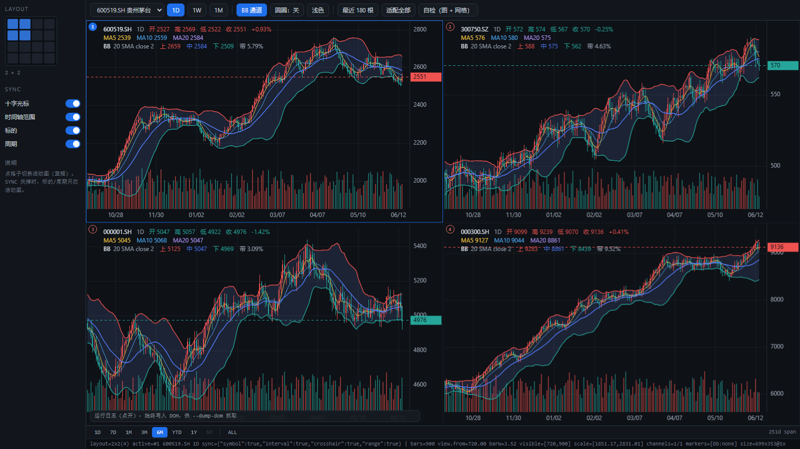
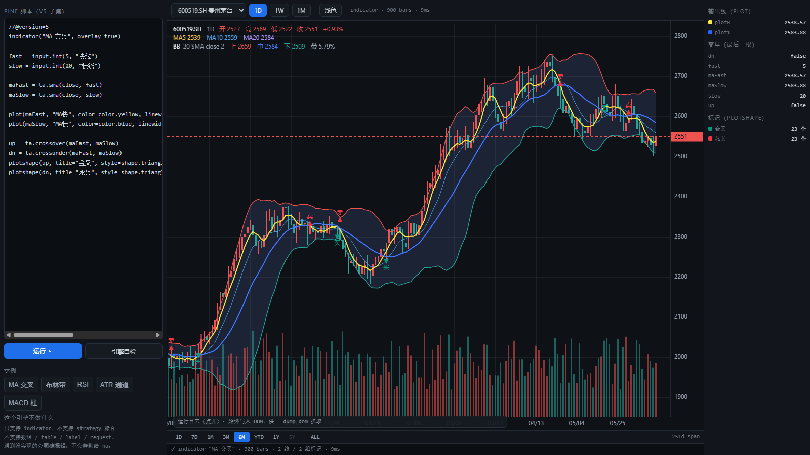

# tv-chart · TradingView 风格图表核心 + Pine v5 子集引擎（TypeScript，零依赖）

用纯 TypeScript 手写的图表核心与 Pine 解释器，**不依赖任何第三方库**
（不用 lightweight-charts，不用 Vela，不用 D3，不用 PineTS）。

两个页面：

| 页面 | 内容 |
| --- | --- |
| `index.html` | **多图工作区** —— 1×1~4×4 网格、联动、通道、显示范围条 |
| `pine.html` | **Pine 编辑器** —— 左边写脚本，右边看图上输出 + 变量快照 |

| 多图工作区 | Pine 编辑器 |
| --- | --- |
|  |  |

（两张图都是 headless Chrome 实际跑出来的，不是设计稿。）

---

## 1. 跑起来

**直接双击 HTML 就能跑** —— `.js` 都是经典脚本（无 `import` / `export`），
所以 `file://` 和 `http://` 都可以，不存在 ESM 的 CORS 问题。

想走 http 也可以，自带一个最小静态服务：

```bash
cd tv-chart
node server.mjs
# http://127.0.0.1:5180/index.html   多图工作区
# http://127.0.0.1:5180/pine.html    Pine 编辑器
```

`index.html` 界面：

- **左侧 LAYOUT** —— 4×4 方块选 1×1 ~ 4×4 布局（最多 16 图），像 TradingView 那样悬停高亮
- **左侧 SYNC** —— 十字光标 / 时间轴范围 / 标的 / 周期，四个联动开关
- **顶栏** —— 标的、**1D/1W/1M（K 线周期）**、BB 通道、圆圈规则、深浅主题、自检
- **底部范围条** —— **1D / 7D / 1M / 3M / 6M / YTD / 1Y / 5Y | ALL（视口覆盖多长时间）**，
  数据不够长的自动置灰，手动缩放后高亮会跟着走
- **网格** —— 每格是独立图表；左上角编号徽章，**蓝框那格是活动图**
  （关掉 SYNC 时，换标的/周期只改它）
- **左下角运行日志** —— 点开看完整日志，含自检逐条 `PASS` / `FAIL`

操作：滚轮缩放（锚定光标下那根）、拖拽平移、双击适配、十字光标吸附到 bar 中心并**联动到其它格**。

> ⚠️ 早期版本用的是 `<script type="module">` + `import './chart.js'`，**双击打开必然白屏**
> —— 模块被 CORS 拦掉、页面却什么也不说。现在已改成经典脚本，并且**加载失败会大声报错**
> （见 §13 排查）。

直接操作图：

| 操作 | 效果 |
| --- | --- |
| 滚轮 | 缩放，**锚定光标下的那根 bar**（它不会跑） |
| 按住拖动 | 平移 |
| 双击 | 适配全部 |
| 鼠标移动 | 十字光标（吸附到 bar 中心）+ 双轴反色标签 + 图例切换到该根 |

---

## 2. 文件

| 文件 | 说明 |
| --- | --- |
| `chart.ts` | **唯一真相**。单个图表，约 1100 行 TypeScript。**全局脚本**（无 import/export） |
| `grid.ts` | **唯一真相**。多图网格 + 联动，约 450 行 |
| `pine.ts` | **唯一真相**。Pine v5 子集解释器，约 1100 行 |
| `chart.js` / `grid.js` / `pine.js` | `tsc` 生成的产物。**别手改**（见 §5） |
| `index.html` | 多图工作区页面 |
| `pine.html` | Pine 编辑器页面 |
| `run-tests.js` | 在 Node 里跑 Pine 自检（不需要浏览器） |
| `server.mjs` | 最小静态服务，默认 `127.0.0.1:5180`（**可选**，双击 HTML 即可） |
| `tsconfig.json` | `strict: true`，`target/module: ES2020`，include 三个 .ts |

> **为什么是全局脚本而不是 ESM 模块？** 因为「单页 HTML + 无构建」这个目标下，
> 双击打开是最自然的用法，而 ESM 的 `import` 在 `file://` 下会被 CORS 直接拦死。
> 代价是 `TVChart` / `ChartGrid` / `PineEngine` 等成为全局名字。
> 如果你要把它当模块用，把 `.ts` 里的声明重新加上 `export`、并把页面换回
> `<script type="module">` + `import` 即可（那时就必须走 http）。

---

## 3. 已实现

**图表（`chart.ts`）**

- **蜡烛图** + 成交量副条（A 股习惯：涨红 `#ef5350` / 跌绿 `#26a69a`）
- **价格轴 / 时间轴**：1/2/5×10^k 的 nice ticks，刻度数量随高度/宽度自适应，价签小数位随步长自动定
- **十字光标**：吸附到 bar 中心，双轴反色标签，图例显示**光标所在那根**的 OHLC + 涨跌幅
- **滚轮缩放（光标锚定）+ 拖拽平移 + 双击适配**，视口夹紧（拖不到天边、缩不到 0.02px）
- **MA5 / MA10 / MA20** 叠加线
- **通道（Channel）** —— TradingView 里 BB / 肯特纳 / 唐奇安 的统一画法：
  上下轨 + 中轨三条线 + **上下轨之间的半透明填充**。默认带一条 `BB 20 SMA close 2`。
  填充画在 K 线**后面**、三条线画在 K 线**上面**（顺序错了要么糊蜡烛、要么线被自己盖住）
- **通道上的小圆圈**可切换三种规则：关 / 碰带 / 带宽极值
- **指标图例按行堆叠**（跟 TradingView 一样）：主图 OHLC 一行、MA 一行、每条通道一行
  （名字 + 参数 + 上/中/下轨当前值 + 带宽 %）
- **深/浅两套主题** —— 只换背景/网格/文字/光标，**不碰涨跌色**（涨跌是 A 股习惯，不该跟着主题走）
- **多周期合成** `resample(bars, '1W' | '1M')` —— 周/月线由日线合成
- **显示范围条** `setRange('1D'|'7D'|'1M'|'3M'|'6M'|'YTD'|'1Y'|'5Y'|'ALL')` —— 见 §9
- **最新价虚线 + 右侧价格标签**（按最后一根涨跌着色）
- **DPR 适配**（`setTransform(dpr,0,0,dpr,0,0)`，坐标全部用 CSS 像素）+ `ResizeObserver`
- **实时更新**：`chart.update(bar)`，同 `time` = 覆盖最后一根，更大 `time` = 追加
- **数据清洗**：`normalizeBars()` 过滤 NaN → 按 open time 升序 → 同 time 去重
- **通用叠加线 / 打点标记** `addLine()` / `addMarkers()` —— Pine 的输出就走这两个口

**多图网格（`grid.ts`）**

- **Layout + Sync**：1×1 到 4×4 共 16 格，每格是**独立的 `TVChart` 实例**
  （各自有坐标轴、图例、指标、缩放）；联动项：十字光标 / 时间轴范围 / 标的 / 周期
- 联动**按时间对齐**（`viewTimes()` / `setViewTimes()` / `indexAtTime()` 二分），不按像素 —— 见 §10

**Pine 引擎（`pine.ts`）—— T3 Phase 1，见 §11**

- 词法（**缩进敏感**）/ 语法 / **序列语义运行时** / 45 个内置 / plot·plotshape 输出
- 手算期望值的自检 **49 条**，Node 和浏览器里都能跑

## 4. 刻意没做（T2 / T3 的边界）

- **同一张图里的多副图（pane）** —— 上下叠在一个画布里、拖分隔条改高度。
  这和 §10 的多图网格不是一回事：网格是 N 个独立实例，副图是 1 个实例切 N 块。
- 绘图工具（趋势线/射线/矩形/斐波那契 + 命中检测 + 手柄 + 磁吸 + undo/redo）→ T2
- 数据源协议（反向分页、订阅、交易日历）、布局存档（localStorage）→ T2
- 移动端双指缩放 / 惯性滑动 → T2（现在只处理了单指拖拽 + `touch-action: none`）
- **Pine Script 引擎、79 种绘图工具对等、Bar Replay** → T3，不在承诺范围

---

## 5. 构建与测试

`.ts` 是唯一真相，`.js` 全部由 `tsc` 生成 —— **不要手改 `.js`**。

TypeScript 装在 `../.tools`（没有全局 tsc）：

```powershell
# 类型检查（不产出）
cd tv-chart
node ..\.tools\node_modules\typescript\bin\tsc -p tsconfig.json --noEmit

# 正式编译：产出 chart.js / grid.js / pine.js
node ..\.tools\node_modules\typescript\bin\tsc -p tsconfig.json

# Pine 引擎自检（纯 Node，不需要浏览器）
node run-tests.js
```

没装过的话：

```powershell
mkdir ..\.tools; cd ..\.tools
'{"name":"tools","private":true}' | Out-File -Encoding ascii package.json
npm install typescript@5.4.5 --no-audit --no-fund
```

> **踩过的坑**：`tsconfig.json` 里写 `"outDir": "."` 会让 tsc 自动排除输出目录
> （也就是源码目录本身），报 `TS18003: No inputs were found`。
> 不写 `outDir` 时 tsc 就在 `.ts` 旁边生成 `.js`，正好是我们要的。
>
> 本机环境：Node 14.21.3 / npm 6.14.18 —— npm 6 下 `npx --yes` 不可用，
> 直接调 `node <路径>/tsc` 最省事。

### 为什么是全局脚本而不是 ESM 模块

两个原因，都是实测出来的：

1. **`file://` 双击就能跑。** `<script type="module">` 的 `import` 在 `file://` 下会被
   CORS 拦死，页面白屏而且什么都不说。经典脚本没有这个问题。
2. 代价是 `TVChart` / `ChartGrid` / `PineEngine` 等成为全局名字。

因为不用 ESM，`.ts` 里也没有 `import`/`export`，所以还额外限制成
**只使用可擦除类型语法**（无 `enum` / 装饰器 / `namespace` / 参数属性）。
这条现在不是必需的，但保留着 —— 万一哪天要临时手改 `.js`，它保证类型一擦就没。

### 能编译、能执行之后，抓到了这些真 bug

这份代码的前几轮是在**跑不了 `tsc`、跑不了浏览器**的情况下写的，全靠通读。
工具链一恢复，第一次 `tsc --noEmit` + 第一次执行就抓出 12 个问题：

| # | 问题 | 性质 |
| --- | --- | --- |
| 1 | `tsconfig` 里 `"outDir": "."` 让 tsc 把自己排除了 → `TS18003` | 配置 |
| 2 | `near()` 的 `eps` 忘了写默认值，22 处调用报 `TS2554` | 编译期 |
| 3 | `catch (e)` 里 `e.message`，`strict` 下 `e` 是 `unknown` | 编译期 |
| 4 | **`ta.change(src, 1)` 永远返回 na**（窗口只装了当前值） | **数值错误，静默** |
| 5 | `input.int(3, "N")` 的**位置参数** title 不认，覆盖失效 | 功能失效，静默 |
| 6 | **`indicator(title, overlay=…)` 存的是 AST 节点**，于是 `!!opts.overlay` **恒为 true** | **语义错误，静默** |
| 7 | `bgcolor(na)` 也记账（Pine 里表示"这根不染色"） | 语义错误 |
| 8 | `pine.html` 成功后没改 `statusEl.textContent`，看门狗误报"没启动起来" | UI |
| 9 | 自检靠 `requestAnimationFrame` 驱动，headless/后台标签页里**根本不触发** | 测试基础设施 |
| 10-12 | `ta.atr` / `bgcolor` / 自引用声明三条**是我的期望值算错了**，引擎是对的 | 测试写错 |

**最值得看的是 4 和 6**：都是"不报错、只是数不对"的那一类。
第 6 条尤其典型 —— 把 AST 节点当值存进元信息，`!!对象` 永远是 `true`，
于是 `overlay=false` 的脚本照样被当成叠加图。这种错**通读很难发现**，
因为代码看起来完全合理。

> 结论：前面几轮"通读代替编译器"抓出了 2 个会白屏的硬错误（重复声明、模块 CORS），
> 但**漏掉了至少 4 个静默数值错误**。静默错误才是这类代码真正的敌人。

---

## 6. 无头验证（改完必跑）

```powershell
# 1) 起服务
node tv-chart/server.mjs

# 2) 截图 + 抓 DOM（日志和自检结果都在 HTML 里）
& 'C:\Program Files\Google\Chrome\Application\chrome.exe' `
  --headless=new --disable-gpu --enable-unsafe-swiftshader `
  --window-size=1280,800 --virtual-time-budget=20000 `
  --screenshot=tv-chart\shot.png --dump-dom "http://127.0.0.1:5180/" | Out-File -Encoding utf8 tv-chart\dom.html

# 3) 判定：有没有 FAIL
Select-String -Path tv-chart\dom.html -Pattern 'FAIL|SELFTEST|READY'
```

`--screenshot` **单独用不落盘**，必须和 `--dump-dom` 一起用并把 stdout 重定向出去。

**判两条线**（别只看一条）：

- **模型层** → `--dump-dom` 里的 `PASS/FAIL` 与 `debugInfo()`（`bars=/view.from=/visible=/scale=`）
- **渲染层** → `--screenshot` 出来的图，人眼看蜡烛、坐标轴、十字光标、图例对不对

模型层全绿但渲染层是空白/糊成一团，是这类代码最典型的失败模式——所以自检里专门有一条
`画布上确实画了东西（背景之外有像素）`，它直接 `getImageData` 采样像素，不依赖任何模型状态。

> ⚠️ **自检不能用 `requestAnimationFrame` 单独驱动。** 后台标签页和 headless 未合成页面里
> rAF 可能根本不触发，表现为「页面启动了但自检没跑」——`index.html` 因此白跑了一轮。
> 现在两页都是 `rAF` + `setTimeout(400)` 兜底，用 flag 去重。

### 当前实测结果

```
node run-tests.js                                   → Pine 自检  49 PASS / 0 FAIL
chrome --dump-dom .../index.html                    → SELFTEST  54 PASS / 0 FAIL
chrome --dump-dom .../pine.html                     → PINETEST  49 PASS / 0 FAIL
```

（`SELFTEST 54` = 图表 48 + 网格 6。）

### 自检覆盖了什么

`selfTest(chart)` 共 48 条，其中**唯一一条真正的行为断言**是缩放不变量：

> 在像素 `px` 处缩放 1.9 倍，`chart.iOf(px)` 在缩放前后必须**完全相等**（容差 1e-6）。

这条挂了，手感一定是错的。其余覆盖：数据升序/去重/OHLC 合法性、`sma` 对朴素均值、
BOLL 中轨 = sma(20) 且上下轨对称、**通道三条轨处处有序 + 填充按缺口切段 + 上下轨被算进自动缩放**、
**`resample` 的 open/close/high/low/volume/time 五条合成规则 + `indexAtTime` 二分 + 时间轴范围同步**、
**9 条显示范围断言（1Y≈365 天 / 1M≈30 天 / YTD 落在元旦 / 5Y 数据不够要置灰）**、
`niceStep` 只产出 1/2/5×10^k、索引↔像素与价格↔像素的往返互逆、
`barW` 夹紧、`fitContent`/`showLast` 的可见区间、`update()` 三种语义（覆盖/追加/拒绝乱序）。

> 三条最容易写错成「假失败」的断言，都做了防御：
> · 两条涉及 `barW` **1px 下限**（`fitContent` / `setViewTimes`）—— 4×4 布局每格只有约 90px，
>   装不下是**正确行为**，写成「首尾都必须可见」一换密集布局就红；
> · 范围的跨度容差**按当前 bar 间距算**，不是写死 ±30 天 ——
>   月线一根就 30 天，写死的话切到 1M 再点自检必红。

> 两条涉及 `barW` **1px 下限**的断言（`fitContent` / `setViewTimes`）都写成「装得下时才要求首尾覆盖」。
> 4×4 布局下每格只有约 90px 绘图宽，装不下是**正确行为**——
> 写成「首尾都必须可见」的话，一换成密集布局就假失败。

> 自检跑完会把自己改过的状态还原（视图恢复、测试插入的那根 bar 弹出），
> 所以「重跑自检」点多少次结果都一样。

---

## 7. 设计说明（改代码前先看这几条）

**① 全部渲染只经过四个函数。** 其余代码都不碰坐标系：

```ts
xOf(i)     // bar 索引 → 左边缘像素 x
xCenter(i) // bar 索引 → 中心像素 x
iOf(px)    // 像素 x → bar 索引（小数）
yOf(p) / pOf(py)   // 价格 ↔ 像素 y
```

**② 光标锚定缩放的全部秘密就三行**——先记住锚点索引，改完 `barW` 再反推 `from`：

```ts
const anchor = this.iOf(px);
this.view.barW = clamp(this.view.barW * k, 1, 60);
this.view.from = anchor - (px - this.plot.l) / this.view.barW;
```

**③ `view.from` 是浮点数，不是整数。** 它是「最左侧那根 bar 的索引」，可以落在两根之间。
一旦你把它取整，缩放就会一格一格地跳，手感立刻崩。

**④ 时间戳铁律**：`bar.time` 必须是该 bar 的**开盘时间**、**epoch 毫秒**。
秒级时间戳（`< 1e11`）是自建数据源的头号坑；它不会报错，只会让整张图的时间轴错到 1970 年。

**⑤ 自动缩放的输入是「可见区间内的 low/high + 所有生效的叠加线」**，
不是全量数据。`computeScale()` 里对叠加线也要取 min/max，否则打开 BOLL 时上下轨会被切掉。

**⑥ 性能现状**：`update()` 每次全量重算指标（800 根 < 1ms，够用）。
真要上 10 万根，需要换成 typed array + 只重算尾部 + 缩到很小时做 LOD 聚合——现在没做，别假装有。

**⑦ `barW` 有 1px 下限**，所以 `fitContent()` 在「bar 数量 × 1px > 绘图宽度」时**装不下全部**，
此时它会靠右对齐、保证最后一根可见。自检里这条断言写的就是这个真实契约（`canFit` 分支），
不是「首尾都可见」那种在窄窗口下会假失败的写法。真要装下 5000 根，就得做 LOD 聚合。

---

## 8. 通道（Channel）怎么写

这就是你要的那个效果。接口：

```ts
const ch = chart.addChannel({
  id: 'bb',
  name: 'BB',
  params: '20 SMA close 2',
  upper: { name: 'UPPER', color: '#ef5350', values: upperArr, width: 1.4, dash: [] },
  basis: { name: 'BASIS', color: '#4d7cff', values: midArr,   width: 1.4, dash: [] },
  lower: { name: 'LOWER', color: '#26a69a', values: lowerArr, width: 1.4, dash: [] },
  fill: 'rgba(120,160,255,0.13)',
  marker: 'none',        // 'none' | 'touch' | 'extremum'
});

chart.setChannelVisible('bb', false);
chart.setChannelMarker('bb', 'touch');
chart.setTheme('light');          // 'dark' | 'light'
```

`upper` / `basis` / `lower` 就是三条 `(number | null)[]`，长度必须对齐 `bars`，
**样本不足的地方给 `null`** —— 别给 0，0 会被当成真实价格，把纵轴一直拉到地上。

**四个容易踩的点：**

1. **填充必须切段画。** 前 `n-1` 根是 null，中间也可能有缺口。整段走一条路径的话，
   填充会横跨缺口连成一片 —— 画出一段根本不存在的「通道」。`channelRuns()` 就是干这个的。
2. **填充画在 K 线后面，三条线画在 K 线上面。** 顺序反了：要么半透明色糊住蜡烛，
   要么线条被自己的填充盖掉一头。
3. **上下轨必须参与自动缩放**，否则一开通道，超出价格区间的上下轨就被切掉了。
   `activeLines()` 里已经算进去了。
4. **实时 tick 只重算 `values`，不要重建通道对象。** `buildIndicators()` 每次 `update()`
   都会被调用；如果它 `new` 一个通道，用户设的颜色 / 填充 / marker 每根 tick 都被冲回默认值。

换成肯特纳 / 唐奇安只是换算法，**画法一行都不用动** —— 这也是把它抽象成 `Channel`
而不是写死成 BOLL 的原因。

> 关于截图里那几个小圆圈：我判断不了它的确切规则（出现频率远低于「碰带」，也不像带宽极值），
> 所以给了 `touch`（high/low 触及轨）和 `extremum`（轨的局部极值）两种可切换实现。
> 你用「圆圈」按钮点两下看哪个对，告诉我我再定下来。

---

## 9. 显示范围 ≠ K 线周期（最容易混的一件事）

底部那条 `1D 7D 1M 3M 6M YTD 1Y 5Y ALL` 和顶栏的 `1D 1W 1M` **是两个正交的维度**：

| | 顶栏 `1D / 1W / 1M` | 底部 `1D / 7D / … / ALL` |
| --- | --- | --- |
| 含义 | **每根 bar 代表多久** | **视口覆盖多长时间** |
| 术语 | interval / 周期 | range / 显示范围 |
| 改了会怎样 | 重新合成 K 线，bar 数量变了 | 只是缩放平移，K 线一根没变 |
| 存哪 | `chart.setBars(barsFor(t, tf))` | `chart.setRange(key)` |

所以「1D 周期 + 1Y 范围」= 365 根日线；「1W 周期 + 1M 范围」= 约 4 根周线。
两个都能用，互不干扰。

```ts
chart.setRange('1Y');          // true  = 数据够长，已按 1 年显示
chart.setRange('5Y');          // false = 数据不够，已退化成「从头开始」
chart.rangeAvailable('5Y');    // false —— 底部按钮靠这个置灰
chart.viewSpan() / 86400000;   // 当前视口覆盖多少天
```

**三个必须处理的边界：**

1. **数据不够长。** 只有 3.5 年数据时点「5Y」，正确答案不是把图压成一条线，
   而是**退化成 ALL 并且如实返回 `false`** —— 调用方据此把按钮置灰。
   `rangeAvailable()` 就是干这个的。TradingView 也是这么做的（灰掉的按钮点不动）。
2. **范围小于一根 bar。** 日线图上点「1D」会算出 1 根 bar，整屏一根蜡烛，很难看。
   所以有 `MIN_RANGE_BARS = 5` 兜底。
3. **手动缩放后高亮要跟着走。** 底部哪个按钮亮着，是按**当前视口跨度**反推的
   （对数距离最近 + 容差 1.6 倍，`YTD` 和 `ALL` 单独判），
   不是记住「上次点了哪个」。否则你一拖鼠标，高亮就开始说谎。

`grid.setRange(key)` 作用于**活动格**，然后走正常的 `sync.range` 通道联动到其它格 ——
不需要为范围单开一条同步逻辑。

---

## 10. 多图网格 + 联动

左侧 Layout 选 1×1 ~ 4×4（最多 16 格），Sync 四个开关控制联动。
每格左上角有编号徽章，**蓝框那一格是「活动图」**——关掉 SYNC 时，换标的/周期只改它。

```ts
const grid = new ChartGrid('#grid', {
  rows: 2, cols: 2,
  theme: 'dark',
  legendInset: 34,                       // 给左上角徽章让位
  sync: { symbol: true, interval: true, crosshair: true, range: true },
});

grid.setLayout(3, 4);                    // 任意 r×c，最多 4×4
grid.setSync('crosshair', false);
grid.setSymbol('300750.SZ');
grid.setTimeframe('1W');
grid.eachTile((c) => c.setChannelVisible('bb', false));
grid.charts()[0].debugInfo();
```

**关键设计：每格是独立的 `TVChart` 实例，不是一个画布切几块。**
所以每格有自己的坐标轴、图例、缩放、指标、通道——这才叫「多个图表」。
（同一张图上下叠副图是另一件事，见 §4。）

**六个真会踩的坑：**

1. **联动必须按时间对齐，不能按像素。** 两格周期不同（1D vs 1W）时，
   同一个像素 `x` 指的根本不是同一时刻。所以 `TVChart` 暴露的是
   `viewTimes()` / `setViewTimes(t0, t1)` 和 `setSyncIndex(idx)`，
   **不是** `getView()` / `setView()` 那种像素接口。用 `indexAtTime()` 二分换算。
2. **网格轨道要用 `minmax(0, 1fr)`，不能用 `1fr`。** 用 `1fr` 时画布的固有尺寸
   会把轨道撑开，整个网格横向溢出、右侧几格跑到屏幕外。这是 CSS Grid 的经典坑。
3. **纵向的价格标签只在鼠标真正所在的那一格画。** 联动的其它格没有「鼠标的纵坐标」
   这回事，硬画一个价格标签是编数据。所以 `pointer`（本图鼠标）和 `syncIndex`
   （外部同步）是两个独立字段：横线 + 时间标签跟着 `syncIndex` 走，横线 + 价格标签跟着 `pointer` 走。
4. **关掉十字光标联动时要清掉别格残留的 `syncIndex`**，否则那几格会永久留一条摘不掉的竖线。
5. **重入。** `setViewTimes()` 会改视口，如果它也回调 `onView`，就会 A→B→A 无限来回。
   `ChartGrid` 用 `busyGuard` 把批量操作期间的画面回调全部屏蔽；`setViewTimes` 本身不发回调。
6. **`setLayout` 要复用已有格子而不是全部重建**（`ensureTiles` 只增删差额），
   否则每改一次布局，所有图的缩放和十字光标状态都被重置。

> 现在**主题**是全体同步的（`grid.setTheme` 作用于所有格），没有做成独立开关。
> 要的话加一条 `sync.style` 就行。

---

## 11. Pine v5 子集引擎（`pine.ts`）

**先说清楚它不是什么**：这是**子集**，不是 Pine 兼容实现。我不承诺、也不假装它能跑任意脚本。
理由不是我懒 —— 是这件事本身就很难，而且**证据就在你自己的仓库里**：
`../vela-h5-test/PINE-对齐清单.md` 记录的是 **PineTS 0.11.1**（专门的、活跃维护的引擎）
在 `default_qty_value=100` 时会**静默归零整个回测**，且只要产生空头持仓就多记 24 笔幽灵同日进出。
一个成熟的专用引擎都会在这种地方翻车，说明"能跑"和"数对"之间差着很远。

### 执行模型：难的不是语法，是这三条

Pine 的语法很浅，真正决定数值对不对的是执行模型。这三条搞错任何一条，
指标就会**静默错掉**——不报错，只是数不对：

1. **每个变量都是一条时间序列。** 脚本对每根 bar 重跑一遍，`x[1]` 取上一根的值。
   实现上每根 bar 末尾**统一结算**（`commit()`），不是赋值时就写历史 ——
   否则 bar 中途的多次赋值会污染 `[1]`。
2. **`var` 的初值只在第 0 根执行一次。** 之后每根只保留、不重算。
3. **内置函数的状态按调用点隔离。** 两个地方各写一遍 `ta.sma(close, 20)`，
   必须是两条独立的滚动和。实现上按 **AST 节点**记忆状态（`PEnv.state(node)`），
   用户函数则是每个调用点一个独立 `PEnv`。

自检里有两条专门盯这个：
`同一个 ta.sma 在两个调用点互不干扰`、`函数体里的 ta.sma 跨 bar 保持状态`。

### 支持

```
//@version=5 / indicator() / strategy()（仅声明，不撮合） / input.*
变量：x =   x :=   var x =   [a, b] = f()
控制：if / else / if 当表达式 / for [to] [by] / while / 三元
函数：f(a, b) => expr   和   多行缩进体（最后一条表达式的值即返回值）
序列：x[n]，以及 ta.sma(...)[n] 这类兜底
算子：+ - * / %   == != < <= > >=   and or not   ?:   字符串 +
内置：ta.{sma,ema,rma,wma,rsi,atr,tr,highest,lowest,change,roc,stdev,cum,
       crossover,crossunder,barssince,valuewhen,macd,bb}
      math.* / nz / na / fixnan / str.tostring / str.length / color.*
      plot / plotshape / plotchar / bgcolor / hline
```

**明确不支持**（遇到就抛错，不静默给 na）：`strategy.*` 撮合、数组/矩阵/map、
`request.*` / `table.*` / `label.*` / `line.*` / `box.*`、`fill()`、`barstate.*`。

### 用法

```ts
const eng = new PineEngine(code, chart.bars, { inputs: { '快线': 8 } });
eng.run();
eng.applyTo(chart);          // plot → 图上的线，plotshape → 三角标记
eng.snapshot();              // 最后一根 bar 上所有变量的值
eng.plots / eng.marks / eng.hlines / eng.bg;
eng.error;                   // 解析/运行时错误信息
```

`input.*` 的覆盖键取 **title**，`input.int(3, "N")` 和 `input.int(3, title="N")` 都认
（只认 kwargs 的话位置写法会被静默忽略 —— 这是我踩过的坑）。

### 这个引擎的数字，验证到什么程度

**能验证的**：45+ 条手算期望值的断言，覆盖序列语义、`var`、调用点隔离、
ta.* 的递推公式（EMA/RMA 的 SMA 播种、RSI、ATR、BOLL、MACD）、元组解构、
控制流、na 传播、以及「未实现的东西必须抛错」。

**不能验证的**：`ta.ema` 的**播种方式**（我用 SMA 播种 + `alpha=2/(len+1)`）是按
TradingView 文档实现的，但**没有对着真实 TV 逐值核过**。你的 `PINE-对齐清单.md` 里那套
校准方法（`npm i pinets@0.11.1` 跑同一个脚本比 `closedtrades` / `netprofit`）用在这里才合适 ——
那需要能跑 PineTS 的环境，我没做。

> 换句话说：**引擎内部自洽且公式对文档**，但**不等于和 TradingView 数值一致**。
> 这个差别必须说清楚，否则回测出来的数会给你假的信心。

---

## 12. T3 分解与进度

前面我说 T3「不承诺」，是因为它不是一件事，是四件难度差一个数量级的事：

| T3 工作流 | 状态 | 说明 |
| --- | --- | --- |
| **Pine 引擎** | ✅ Phase 1 完成 | 词法+语法+序列运行时+45 内置+plot 输出，49 条自检 |
| Pine 撮合（`strategy.*`） | ⬜ Phase 2 | 下单/持仓/手续费/滑点/权益曲线/绩效指标 |
| **Bar Replay** | ⬜ | 便宜且价值高（~200 行）：截断序列 + 步进 + 自动播放 |
| **绘图工具** | ⬜ | 框架可做（命中检测/手柄/磁吸/undo/持久化）；**79 种工具全量不承诺** |
| 告警面板 | ⬜ | ~150 行，价值低 |
| **逐像素视觉对等** | ❌ 不做 | 需要参考截图逐帧比，我没有也不打算声称有 |
| Pine **全兼容** | ❌ 不接 | 见 §11 开头，理由不是懒 |

**下一步建议顺序**：Bar Replay（最小改动、立刻能用）→ Pine 撮合（你真正关心的回测）
→ 绘图工具框架。

---

## 13. 排查：页面卡在 `booting…`

`booting…` 是 `#status` 的初始文本，只有 `report()` 会改写它。它一直不变 = **业务脚本压根没执行**。
最常见的原因按概率排序：

| 现象（看 `#log`） | 原因 | 处理 |
| --- | --- | --- |
| `✗ 资源加载失败：<script> …/chart.js` 或 `typeof TVChart = undefined` | `chart.js` 不在 `index.html` 同级目录，或文件名被改 | 确认两个文件在同一目录 |
| `✗ JS 错误：… @行:列` | `chart.js` 被改坏 / 复制时截断 | 重新生成（§5） |
| `✗ 2 秒内没启动起来。protocol=file:` | 早期 ESM 版本的 CORS 问题 | 本版本已改经典脚本，不该再出现 |

页面现在有三层保险，**任何一层触发都会把原因写进 `#log` 并把 `#status` 染红**：

1. **`window.addEventListener('error', …, true)`** —— 捕获 JS 错误 *和* 资源加载失败
   （资源错误只在**捕获阶段**冒泡到 window，所以第三个参数必须是 `true`，这是关键）
2. **`typeof TVChart !== 'function'` 前置检查** —— `<script src>` 失败不会抛异常，
   只会在 window 上留一个 `error` 事件，所以必须显式检查标识符在不在
3. **2 秒看门狗** —— 什么都没发生也要说话，并且把 `location.protocol` 打出来

> 教训：**"什么都没发生" 是最差的失败模式。** 一个静默白屏比一个红色报错难查十倍。

---

## 14. 许可

本目录代码为自己手写，无第三方依赖，随你处置。

注意别把这个和 `../vela-h5-test/` 混了：那边用的是 LuxAlgo Vela（核心 Apache-2.0，但 NOTICE
要求保留 Vela™ 角标），它的 `vela-pinets` 是 **AGPL-3.0**，商用需买 license。本目录不涉及。
