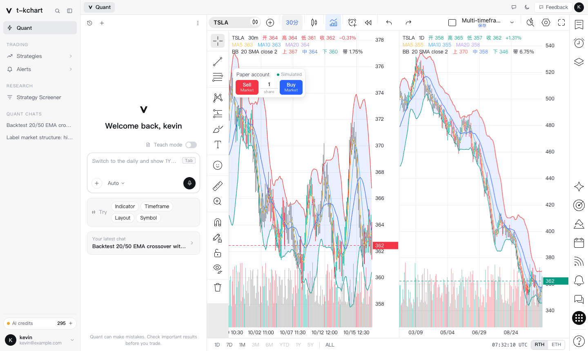
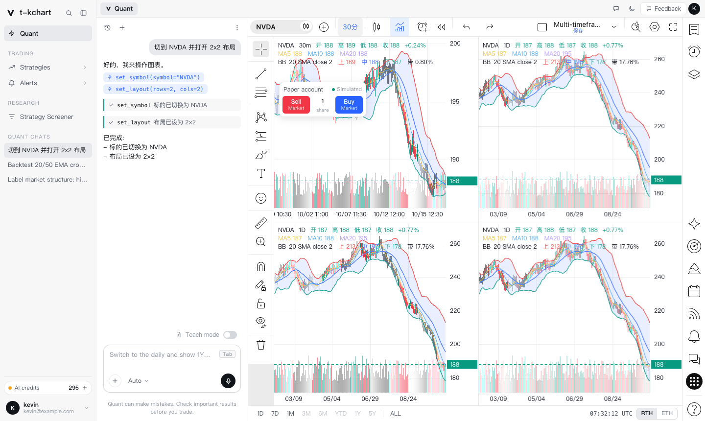

# t-kchart · 三栏量化工作台（TypeScript）

左侧菜单 + 中间 Agent 面板 + 右侧专业图表软件风格的图表区。图表核心与 Pine v5 / v6 子集解释器是**零依赖**的纯 TypeScript 引擎（`src/engine`），外壳是 Vite + React + TypeScript。

> **路线图见 [`TODO.md`](TODO.md)**。本 README 讲「现在是什么」，TODO 讲「接下来做什么、怎么算做完」。



| 区域 | 位置 | 说明 |
| --- | --- | --- |
| 左侧菜单 | `src/sidebar` | Quant / Trading（Strategies、Alerts）/ Research（Strategy Screener）/ Quant chats 会话列表 / AI credits / 用户卡，可折叠 |
| Agent 面板 | `src/agent` | 欢迎页、输入框（Teach mode、模型选择、Tab 补全）、Try 快捷建议、流式消息、工具调用展示；宽度可拖动 |
| 图表区 | `src/workspace` | 顶栏（设计稿原组件：品种胶囊 / 周期 / 图表样式 / 指标 / 警报 / 回放 / 撤销重做 / 布局 / 保存块）、左侧绘图栏、多图联动网格、PaperTrade 模拟下单、底部范围条、右侧图标栏（设计稿原组件）与自选表面板 |
| 引擎 | `src/engine` | `chart` 单图 · `grid` 多图联动 · `draw` 绘图 · `pine` Pine 引擎 · `equity` 权益曲线 · `analytics` 统计组件 |



（截图是 headless Chrome 实际跑出来的。上图：在 Agent 里说「切到 NVDA」「用 1h 周期并打开 2x2 布局」，Agent 发起 `set_symbol` / `set_layout` / `set_timeframe` 工具调用，图表随之变化。）

---

## 1. 跑起来

```bash
npm install
npm run dev          # http://127.0.0.1:5181/
npm run typecheck    # tsc --noEmit（strict）
npm test             # vitest：引擎自检 + Agent / 工作区 / 数据层单测
npm run build        # tsc --noEmit && vite build
```

## 2. 目录

```
src/
  main.tsx  App.tsx
  app/          AppShell（三栏 + 分隔条 + 标签栏）、pages（Strategies / Alerts / Screener）
  sidebar/      Sidebar
  agent/
    types.ts          AgentProvider / AgentMessage / ToolCall / AgentEvent 接口
    runner.ts         Agent 循环：流式输出 → 执行工具 → 结果回灌 → 直到无新调用（maxSteps 兜底）
    tools.ts          图表工具集（set_symbol / set_timeframe / set_range / set_layout / set_chart_style / replay / add_indicator / remove_indicator / list_indicators / run_pine）
    registry.ts       模型下拉与 provider 选择（Auto：配了 harness 地址用 DeepSeek，否则 mock）
    providers/mock.ts       本地演示（关键字 → 工具调用）
    providers/deepseek.ts   DeepSeek harness 适配点（空壳）
    AgentPanel / Composer / MessageList
  workspace/
    ChartWorkspace / TopBar / RangeBar / PaperTrade / RightPanel / RightRail
    ChartGridView     ChartGrid 的 React 外壳（store ⇄ 引擎）
    DrawToolbar       包装 dom/sidebar.ts，经 drawBus 驱动各格 DrawLayer
    chartControls     Agent 工具的真实实现（ChartControls 接口）
    TopBar / RightRail  包装 dom/toolbar.ts / dom/rightbar.ts：store ⇄ 组件句柄（createToolbarHandle / createRightbarHandle）
    dom/              设计稿原生 DOM 组件（顶栏、绘图栏、右侧栏、策略报告面板）与图标
  engine/       chart grid draw pine equity analytics studies layouts replay（ESM，零依赖）
  engine/styleTest.ts   图表样式的浏览器自检（像素）
  indicators/   内置指标库：catalog（全部是 Pine v6 脚本）/ runner（脚本 → 画得出的输出）/ studyTest（浏览器自检）
  data/         mockBars（TSLA/AAPL/NVDA/MSFT/SPY，分钟/小时/日/周/月）
  store/        zustand：appStore / chartStore / chatStore / studyStore（图上的指标 + 收藏 + 对话框状态）
  styles/       tokens.css（设计变量，浅/深两套）+ app.css
  dev/          浏览器侧自检入口
tests/          vitest
docs/           截图
```

数据流：**store 是单一数据源**。`ChartGridView` 订阅 `chartStore` 去驱动 `ChartGrid`；引擎的 `activechange` / `viewchange` 事件再回写 store 或刷新范围条。Agent 工具和顶栏按钮走同一条路径（写 store），所以两边永远一致。

## 3. 接入 DeepSeek harness

UI、runner、图表工具都只依赖 `src/agent/types.ts`，接入只需要实现 `providers/deepseek.ts` 的 `send()`：

1. 把 `req.messages` / `req.tools` 转成 harness 的请求格式（`tools` 是 JSON Schema 子集，已按函数调用风格写好）；
2. 流式调用 harness；
3. 逐段翻译成 `AgentEvent`：`text-delta` / `tool-call`（`arguments` 必须是已解析的对象）/ `done` / `error`。

配置走环境变量（`.env.local`）：

```
VITE_DEEPSEEK_BASE_URL=http://127.0.0.1:8787
VITE_DEEPSEEK_API_KEY=...
VITE_DEEPSEEK_MODEL=deepseek-chat
```

配置了 `VITE_DEEPSEEK_BASE_URL` 后，面板里的 **Auto** 会自动选 DeepSeek，否则用 mock。未实现 / 未配置时会**明确报错**（写进对话），不会静默返回空。

> 注意：`VITE_` 前缀的变量会被打进浏览器包。生产环境不要把 API Key 放前端，应当由 harness 服务端持有密钥。

## 4. 测试

| 层 | 命令 | 内容 |
| --- | --- | --- |
| 类型 | `npm run typecheck` | `strict: true`，0 错误 |
| 引擎（Node） | `npm test` | 绘图 39 + Pine 74 + Pine 撮合 69 + 权益 26 + 统计 34 + 回放 27 + 布局目录 346 = 615（基线，只增不减） |
| 图表样式（Node） | `npm test` | 平均K线手算对数、成交量蜡烛宽度、关键词 → 样式、不可用样式的原因、带标记线渐变色（8 条） |
| 指标库（Node） | `npm test` | 36 个 v6 脚本全部跑通；约 30 个指标的数值与**独立 TS 参考实现**逐根对数；搜索 / 清单 / store / Agent 控制 |
| Agent / 工作区 / 数据 | `npm test` | 意图解析、工具校验、runner 循环（含报错/中断/死循环兜底）、模拟账户不变式、范围高亮、mock 数据不变式 |
| 引擎（浏览器，需 canvas） | 开发模式下控制台 `await __app.runBrowserSelfTests()` | 图表 76 + 网格 20 + 权益 37 + 统计 50 + 指标 19（副图布局 / 像素 / 指针分流 / 回放 / 实时 tick）+ 样式 52（13 种样式的价格轴口径 + 像素） |

`__app` 只在 `npm run dev` 下挂到 `window`，生产包里没有。

---

## 引擎笔记

以下章节来自改造前的 README，讲的是引擎本身的设计与坑，**编号保持不变**（源码注释里引用了 `README §7` / `§9` / `§12` 等）。

> 与现状不一致的地方：
> - 文中提到的 `index.html` / `pine.html` / `chart.html` / `equity.html` / `analytics.html` 等独立页面，以及「全局脚本、双击 HTML 就能跑、`tsc` 生成 `.js`」的做法，已在三栏改造中移除（引擎改为 ESM 模块，由 Vite 构建）。旧页面可在 git 历史里找到（改造前的提交）。
> - 文中的 `chart.ts` 等路径现在位于 `src/engine/`。


## 引擎 §3 已实现

**图表（`chart.ts`）**

- **蜡烛图** + 成交量副条（A 股习惯：涨红 `#ef5350` / 跌绿 `#26a69a`）
- **价格轴 / 时间轴**：1/2/5×10^k 的 nice ticks，刻度数量随高度/宽度自适应，价签小数位随步长自动定
- **十字光标**：吸附到 bar 中心，双轴反色标签，图例显示**光标所在那根**的 OHLC + 涨跌幅
- **滚轮缩放（光标锚定）+ 拖拽平移 + 双击适配**，视口夹紧（拖不到天边、缩不到 0.02px）
- **MA5 / MA10 / MA20** 叠加线
- **通道（Channel）** —— 主流图表软件里 BB / 肯特纳 / 唐奇安 的统一画法：
  上下轨 + 中轨三条线 + **上下轨之间的半透明填充**。默认带一条 `BB 20 SMA close 2`。
  填充画在 K 线**后面**、三条线画在 K 线**上面**（顺序错了要么糊蜡烛、要么线被自己盖住）
- **通道上的小圆圈**可切换三种规则：关 / 碰带 / 带宽极值
- **指标图例按行堆叠**（与主流图表软件一致）：主图 OHLC 一行、MA 一行、每条通道一行
  （名字 + 参数 + 上/中/下轨当前值 + 带宽 %）
- **深/浅两套主题** —— 只换背景/网格/文字/光标，**不碰涨跌色**（涨跌是 A 股习惯，不该跟着主题走）
- **多周期合成** `resample(bars, '1W' | '1M')` —— 周/月线由日线合成
- **显示范围条** `setRange('1D'|'7D'|'1M'|'3M'|'6M'|'YTD'|'1Y'|'5Y'|'ALL')` —— 见 §9
- **最新价虚线 + 右侧价格标签**（按最后一根涨跌着色）
- **DPR 适配**（`setTransform(dpr,0,0,dpr,0,0)`，坐标全部用 CSS 像素）+ `ResizeObserver`
- **实时更新**：`chart.update(bar)`，同 `time` = 覆盖最后一根，更大 `time` = 追加
- **数据清洗**：`normalizeBars()` 过滤 NaN → 按 open time 升序 → 同 time 去重
- **通用叠加线 / 打点标记** `addLine()` / `addMarkers()` —— Pine 的输出就走这两个口

**多图网格（`grid.ts`）**

- **Layout + Sync**：1 到 16 格、55 种排法，每格是**独立的 `KChart` 实例**
  （各自有坐标轴、图例、指标、缩放）；联动项：十字线 / 时间 / 日期范围 / 商品代码 / 周期
- **主图样式**：13 种，`KChart.setStyle()` 切换，`ChartGrid.setChartStyle()` 让所有格一起变。**全部是纯显示层变换**——数据、指标、回放、联动都仍跑在真实 OHLC 上：
  - 蜡烛族：`candles` K线 / `bars` 美国线 / `hollow` 空心K线（涨空心跌实心）/ `volcandles` 成交量蜡烛（实体宽度 ∝ 成交量，见 `volCandleWidth`）/ `heikin` 平均K线（`heikinAshi()` 纯函数，带缓存，实时 tick 改最后一根会失效）
  - 折线族（价格轴只按收盘价取范围）：`line` / `linemarkers` 带标记线（紫→蓝纵向渐变折线 + 实心圆点，渐变锚在可见范围最高 / 最低收盘价）/ `step` 阶梯线 / `area` 面积 / `baseline` 基准线（基准价 = 可见收盘价中点，之上涨色之下跌色）/ `columns` 柱状图
  - 区间族（按最高最低价取范围）：`hlcarea` HLC 区域 / `highlow` 高-低
  - 菜单里有但**做不了**的 8 个（灰显，点了只提示原因，Agent 点名也会如实说明，不会悄悄换成别的样式）：成交量轨迹 / 时间价格机会 / 交易时段成交量分布图（需要逐笔或更小周期数据，数据源只有 OHLC）；砖形图 / 新价线 / 卡吉图 / 点数图 / 范围图（非时间序列，会改变 bar 数量与时间轴，指标 / 回放 / 联动要跟着重做）
  - 顶栏菜单是设计稿的 6 组 21 行，每行有 `?`（说明）与 `☆`（收藏：工具栏上出现该样式的快捷按钮，存 localStorage `kc.style.favorites`）
- 联动**按时间对齐**（`viewTimes()` / `setViewTimes()` / `indexAtTime()` 二分），不按像素 —— 见 §10

**Pine 引擎（`pine.ts`）—— T3 Phase 1，见 §12**
- 词法（**缩进敏感**）/ 语法 / **序列语义运行时** / 45 个内置 / plot·plotshape 输出
- 手算期望值的自检 **49 条**，Node 和浏览器里都能跑

**绘图工具层（`draw.ts`）—— 见 §11**

- 9 种工具：趋势线 / 水平线 / 垂直线 / 射线 / 矩形 / 斐波那契回撤 / 文字 / 测量 / 光标
- 命中检测（端点手柄 + 整体拖动）、磁吸到 OHLC、锁定、隐藏、撤销重做、JSON 持久化
- 锚点存 **(时间, 价格)** 而不是像素 —— 缩放平移后图形不会飘
- 自检 **39 条**，**纯几何，Node 里就能跑**（靠 `DrawHost` 接口塞假图）

## 引擎 §4 刻意没做（T2 / T3 的边界）

- **同一张图里的多副图（pane）** —— 上下叠在一个画布里、拖分隔条改高度。
  这和 §10 的多图网格不是一回事：网格是 N 个独立实例，副图是 1 个实例切 N 块。
- 绘图工具（趋势线/射线/矩形/斐波那契 + 命中检测 + 手柄 + 磁吸 + undo/redo）→ T2
- 数据源协议（反向分页、订阅、交易日历）、布局存档（localStorage）→ T2
- 移动端双指缩放 / 惯性滑动 → T2（现在只处理了单指拖拽 + `touch-action: none`）
- **Pine Script 引擎、79 种绘图工具对等、Bar Replay** → T3，不在承诺范围

---

---

## 引擎 §7 设计说明（改代码前先看这几条）

**① 全部渲染只经过四个函数。** 其余代码都不碰坐标系：

```ts
xOf(i)     // bar 索引 → 左边缘像素 x
xCenter(i) // bar 索引 → 中心像素 x
iOf(px)    // 像素 x → bar 索引（小数）
yOf(p) / pOf(py)   // 价格 ↔ 像素 y
```

**② 光标锚定缩放的全部秘密就三行**——先记住锚点索引，改完 `barW` 再反推 `from`：

```ts
const anchor = this.iOf(px);
this.view.barW = clamp(this.view.barW * k, 1, 60);
this.view.from = anchor - (px - this.plot.l) / this.view.barW;
```

**③ `view.from` 是浮点数，不是整数。** 它是「最左侧那根 bar 的索引」，可以落在两根之间。
一旦你把它取整，缩放就会一格一格地跳，手感立刻崩。

**④ 时间戳铁律**：`bar.time` 必须是该 bar 的**开盘时间**、**epoch 毫秒**。
秒级时间戳（`< 1e11`）是自建数据源的头号坑；它不会报错，只会让整张图的时间轴错到 1970 年。

**⑤ 自动缩放的输入是「可见区间内的 low/high + 所有生效的叠加线」**，
不是全量数据。`computeScale()` 里对叠加线也要取 min/max，否则打开 BOLL 时上下轨会被切掉。

**⑥ 性能现状**：`update()` 每次全量重算指标（800 根 < 1ms，够用）。
真要上 10 万根，需要换成 typed array + 只重算尾部 + 缩到很小时做 LOD 聚合——现在没做，别假装有。

**⑦ `barW` 有 1px 下限**，所以 `fitContent()` 在「bar 数量 × 1px > 绘图宽度」时**装不下全部**，
此时它会靠右对齐、保证最后一根可见。自检里这条断言写的就是这个真实契约（`canFit` 分支），
不是「首尾都可见」那种在窄窗口下会假失败的写法。真要装下 5000 根，就得做 LOD 聚合。

同一个下限也影响 `setViewTimes(t0, t1)`：目标区间比视口宽时它以 t0 为左边缘往右铺，**静默只显示左侧一段**。
要「让某段时间可见」请用 `revealSpan(t0, t1)`（装不下时靠右对齐 t1，返回 false），`maxVisibleBars()` 给出当前最多能放多少根。
`setRange` 和多图的「范围联动」都走 `revealSpan`。

**⑧ 统计组件的三个对账坑**（都有回归自检）：
1. 回测的 `positions` 在收尾仍持仓时比成交多一段，那段带 `open: true`，**不是一笔成交**；
   把 positions 当成交列表去映射收益率会多出 ret=0 的幽灵交易，直方图各箱之和就对不上总数。用 `closedPositions()`。
2. 直方图分箱和命中判定必须共用 `binIndexOf`：朴素的 `floor((v-lo)/w)` 在浮点边界上会和「`from <= v < to`」差一箱。

---

## 引擎 §8 通道（Channel）怎么写

这就是你要的那个效果。接口：

```ts
const ch = chart.addChannel({
  id: 'bb',
  name: 'BB',
  params: '20 SMA close 2',
  upper: { name: 'UPPER', color: '#ef5350', values: upperArr, width: 1.4, dash: [] },
  basis: { name: 'BASIS', color: '#4d7cff', values: midArr,   width: 1.4, dash: [] },
  lower: { name: 'LOWER', color: '#26a69a', values: lowerArr, width: 1.4, dash: [] },
  fill: 'rgba(120,160,255,0.13)',
  marker: 'none',        // 'none' | 'touch' | 'extremum'
});

chart.setChannelVisible('bb', false);
chart.setChannelMarker('bb', 'touch');
chart.setTheme('light');          // 'dark' | 'light'
```

`upper` / `basis` / `lower` 就是三条 `(number | null)[]`，长度必须对齐 `bars`，
**样本不足的地方给 `null`** —— 别给 0，0 会被当成真实价格，把纵轴一直拉到地上。

**四个容易踩的点：**

1. **填充必须切段画。** 前 `n-1` 根是 null，中间也可能有缺口。整段走一条路径的话，
   填充会横跨缺口连成一片 —— 画出一段根本不存在的「通道」。`channelRuns()` 就是干这个的。
2. **填充画在 K 线后面，三条线画在 K 线上面。** 顺序反了：要么半透明色糊住蜡烛，
   要么线条被自己的填充盖掉一头。
3. **上下轨必须参与自动缩放**，否则一开通道，超出价格区间的上下轨就被切掉了。
   `activeLines()` 里已经算进去了。
4. **实时 tick 只重算 `values`，不要重建通道对象。** `buildIndicators()` 每次 `update()`
   都会被调用；如果它 `new` 一个通道，用户设的颜色 / 填充 / marker 每根 tick 都被冲回默认值。

换成肯特纳 / 唐奇安只是换算法，**画法一行都不用动** —— 这也是把它抽象成 `Channel`
而不是写死成 BOLL 的原因。

> 关于截图里那几个小圆圈：我判断不了它的确切规则（出现频率远低于「碰带」，也不像带宽极值），
> 所以给了 `touch`（high/low 触及轨）和 `extremum`（轨的局部极值）两种可切换实现。
> 你用「圆圈」按钮点两下看哪个对，告诉我我再定下来。

---

## 引擎 §9 显示范围 ≠ K 线周期（最容易混的一件事）

底部那条 `1D 7D 1M 3M 6M YTD 1Y 5Y ALL` 和顶栏的 `1D 1W 1M` **是两个正交的维度**：

| | 顶栏 `1D / 1W / 1M` | 底部 `1D / 7D / … / ALL` |
| --- | --- | --- |
| 含义 | **每根 bar 代表多久** | **视口覆盖多长时间** |
| 术语 | interval / 周期 | range / 显示范围 |
| 改了会怎样 | 重新合成 K 线，bar 数量变了 | 只是缩放平移，K 线一根没变 |
| 存哪 | `chart.setBars(barsFor(t, tf))` | `chart.setRange(key)` |

所以「1D 周期 + 1Y 范围」= 365 根日线；「1W 周期 + 1M 范围」= 约 4 根周线。
两个都能用，互不干扰。

```ts
chart.setRange('1Y');          // true  = 数据够长，已按 1 年显示
chart.setRange('5Y');          // false = 数据不够，已退化成「从头开始」
chart.rangeAvailable('5Y');    // false —— 底部按钮靠这个置灰
chart.viewSpan() / 86400000;   // 当前视口覆盖多少天
```

**三个必须处理的边界：**

1. **数据不够长。** 只有 3.5 年数据时点「5Y」，正确答案不是把图压成一条线，
   而是**退化成 ALL 并且如实返回 `false`** —— 调用方据此把按钮置灰。
   `rangeAvailable()` 就是干这个的。参考实现也是这么做的（灰掉的按钮点不动）。
2. **范围小于一根 bar。** 日线图上点「1D」会算出 1 根 bar，整屏一根蜡烛，很难看。
   所以有 `MIN_RANGE_BARS = 5` 兜底。
3. **手动缩放后高亮要跟着走。** 底部哪个按钮亮着，是按**当前视口跨度**反推的
   （对数距离最近 + 容差 1.6 倍，`YTD` 和 `ALL` 单独判），
   不是记住「上次点了哪个」。否则你一拖鼠标，高亮就开始说谎。

`grid.setRange(key)` 作用于**活动格**，然后走正常的 `sync.range` 通道联动到其它格 ——
不需要为范围单开一条同步逻辑。

---

## 引擎 §10 多图网格 + 联动

顶栏「布局」菜单：13 行（1–10、12、14、16 张图）共 **55 种排法**，不只是均匀网格（有「左大右小」「上 1 下 3」「7 列」等），
数据在 `layouts.ts`（每种 = 一组铺满单位方块、互不重叠的矩形；`gridTemplate()` 翻成 CSS Grid 的轨道 + 跨度，图标用设计稿原图标 `src/ui/layoutIcons.ts`，键 = 布局 id，缺图标时退回按几何画的描边框）。
「同步到所有图表」五个开关：商品代码 / 周期 / 十字线 / 时间 / 日期范围。
每格左上角有编号徽章，**蓝框那一格是「活动图」**——关掉 SYNC 时，换标的/周期只改它。

```ts
const grid = new ChartGrid('#grid', {
  layoutId: '4-3',                       // 目录 id；也可以传 rows / cols（只认目录里存在的均匀网格）
  theme: 'dark',
  legendInset: 34,                       // 给左上角徽章让位
  sync: { symbol: true, interval: true, crosshair: true, time: true, range: true },
});

grid.setLayoutId('7-1');                 // 目录里的任意一种；未知 id 返回 false、不动
grid.setLayout(2, 2);                    // 兼容旧入口：只认目录里存在的均匀网格，没有就返回 false
grid.setSync('crosshair', false);
grid.setSymbol('300750.SZ');
grid.setTimeframe('1W');
grid.eachTile((c) => c.setChannelVisible('bb', false));
grid.charts()[0].debugInfo();
```

**关键设计：每格是独立的 `KChart` 实例，不是一个画布切几块。**
所以每格有自己的坐标轴、图例、缩放、指标、通道——这才叫「多个图表」。
（同一张图上下叠副图是另一件事，见 §4。）

**六个真会踩的坑：**

1. **联动必须按时间对齐，不能按像素。** 两格周期不同（1D vs 1W）时，
   同一个像素 `x` 指的根本不是同一时刻。所以 `KChart` 暴露的是
   `viewTimes()` / `setViewTimes(t0, t1)` 和 `setSyncIndex(idx)`，
   **不是** `getView()` / `setView()` 那种像素接口。用 `indexAtTime()` 二分换算。
2. **网格轨道要用 `minmax(0, 1fr)`，不能用 `1fr`。** 用 `1fr` 时画布的固有尺寸
   会把轨道撑开，整个网格横向溢出、右侧几格跑到屏幕外。这是 CSS Grid 的经典坑。
3. **纵向的价格标签只在鼠标真正所在的那一格画。** 联动的其它格没有「鼠标的纵坐标」
   这回事，硬画一个价格标签是编数据。所以 `pointer`（本图鼠标）和 `syncIndex`
   （外部同步）是两个独立字段：横线 + 时间标签跟着 `syncIndex` 走，横线 + 价格标签跟着 `pointer` 走。
4. **关掉十字光标联动时要清掉别格残留的 `syncIndex`**，否则那几格会永久留一条摘不掉的竖线。
5. **重入。** `setViewTimes()` 会改视口，如果它也回调 `onView`，就会 A→B→A 无限来回。
   `ChartGrid` 用 `busyGuard` 把批量操作期间的画面回调全部屏蔽；`setViewTimes` 本身不发回调。
6. **`setLayout` 要复用已有格子而不是全部重建**（`ensureTiles` 只增删差额），
   否则每改一次布局，所有图的缩放和十字光标状态都被重置。

> 现在**主题**是全体同步的（`grid.setTheme` 作用于所有格），没有做成独立开关。
> 要的话加一条 `sync.style` 就行。

---

## 引擎 §11 绘图工具层（`draw.ts`）

页面是 `chart.html`。左侧那排工具背后是这个层。

### 两个关键设计

**① 锚点存 `(时间, 价格)`，不存像素。**

存像素的话，你一缩放/平移，画上去的东西就飘走了。像素只在该渲染的那一刻算。
同一个错误在十字光标联动那里踩过一次（见 §10），所以这次一开始就避开了。
`timeToX()` / `xToTime()` 在相邻两根 bar 之间**线性插值**，否则放大到一根 bar 很宽时图形会一格一格地跳。

**② 依赖 `DrawHost` 接口，不是 `KChart` 类。**

`KChart` 结构化地满足这个接口，所以真图直接能用；测试里塞一个几十行的假图
（只有 `bars` / `plot` / `scale` 和几个变换函数）就能**在 Node 里跑完 39 条几何自检**，
不需要浏览器。这是 `node run-tests.js` 能覆盖绘图层的原因。

### 工具

趋势线 / 水平线 / 垂直线 / 射线 / 矩形 / 斐波那契回撤（7 档）/ 文字 / 测量 / 光标。

每个工具的交互都覆盖：命中检测（端点手柄 vs 整体）、拖动、磁吸、锁定、隐藏、撤销重做、JSON 持久化。

### 和图表的事件契约

绘图层通过 `KChart.setHooks()` 挂进去。唯一的约定是：

```ts
onDown(px, py, e): boolean   // 返回 true = 这次点击被图层接管，KChart 不平移
```

**没有这条约定，一选绘图工具就没法拖动画布了** —— 两边都想吃 pointerdown。
现在：选着工具 → 点击落点、接管；光标模式点到空白 → 返回 false、交给 KChart 平移；
光标模式点到已有图形 → 接管、开始拖动。

### 已知边界

- **视觉是暂行版。** 左侧工具栏的图标/间距/配色是我照主流图表软件的样子做的 ——
  你给的 Magic Patterns 设计稿我打不开（`/imported/...` 是登录态页面，直出 HTTP 500），
  所以**没有**照设计稿实现。改的是皮，上面这套引擎不用动。
- **顶栏和右侧面板还没做**（等设计稿，或按你说的"分次做"下一轮）。
- 79 种工具**不承诺**。框架在了，加一种新工具大约 30~80 行（画法 + 命中 + 手柄）；
  剩下的是内容工作量，不是架构问题。
- 手机端手势没做（只有单指拖拽 + `touch-action: none`）。

---

## 引擎 §12 Pine v5 / v6 子集引擎（`pine.ts`）

**先说清楚它不是什么**：这是**子集**，不是 Pine 兼容实现。我不承诺、也不假装它能跑任意脚本。
理由不是我懒 —— 是这件事本身就很难。**成熟的专用 Pine 引擎一样会翻车**：
仓位按 100% 权益下单时被引擎自己判成「保证金不足」直接拒单、整个回测静默归零；
只要产生空头持仓就多记一批「同日进同出」的幽灵成交。这两类错**都不报错，只是数不对**。
一个成熟的专用引擎都会在这种地方翻车，说明「能跑」和「数对」之间差着很远。

### 执行模型：难的不是语法，是这三条

Pine 的语法很浅，真正决定数值对不对的是执行模型。这三条搞错任何一条，
指标就会**静默错掉**——不报错，只是数不对：

1. **每个变量都是一条时间序列。** 脚本对每根 bar 重跑一遍，`x[1]` 取上一根的值。
   实现上每根 bar 末尾**统一结算**（`commit()`），不是赋值时就写历史 ——
   否则 bar 中途的多次赋值会污染 `[1]`。
2. **`var` 的初值只在第 0 根执行一次。** 之后每根只保留、不重算。
3. **内置函数的状态按调用点隔离。** 两个地方各写一遍 `ta.sma(close, 20)`，
   必须是两条独立的滚动和。实现上按 **AST 节点**记忆状态（`PEnv.state(node)`），
   用户函数则是每个调用点一个独立 `PEnv`。

自检里有两条专门盯这个：
`同一个 ta.sma 在两个调用点互不干扰`、`函数体里的 ta.sma 跨 bar 保持状态`。

### 支持

```
//@version=5 或 6（缺省按 5；其它版本拒绝）/ indicator() / strategy() / input.*
变量：x =   x :=   var x =   [a, b] = f()    类型前缀：float x = …  var int n = 0
赋值：:=  += -= *= /= %=      颜色字面量：#RRGGBB  #RRGGBBAA
控制：if / else / if 当表达式 / for [to] [by] / while（含 break / continue）/ 三元
函数：f(a, b) => expr   和   多行缩进体（最后一条表达式的值即返回值）
序列：x[n]，以及 ta.sma(...)[n] 这类兜底
算子：+ - * / %   == != < <= > >=   and or not   ?:   字符串 +
内置：ta.{sma,ema,rma,wma,rsi,atr,tr,highest,lowest,change,roc,stdev,cum,
       crossover,crossunder,barssince,valuewhen,macd,bb,
       highestbars,lowestbars,dev,cci,mom,cmo,vwma,alma,hma,wpr,stoch,mfi,correlation,dmi}
      ta.tr / ta.obv / ta.accdist（不带括号的内置变量）
      math.*（math.sum 是滚动求和）/ nz / na / fixnan / str.tostring / str.length / color.*
      plot（位置参数、逐根颜色、display=none、返回句柄）/ plotshape / plotchar / bgcolor / hline / fill
      strategy.{entry,close,close_all,exit,cancel,cancel_all}
      strategy.{position_size,position_avg_price,equity,netprofit,openprofit,
                initial_capital,opentrades,closedtrades}（只读变量）
```

**明确不支持**（遇到就抛错，不静默给 na）：`strategy.*` 里除上面之外的（limit/stop 入场单、`risk.*`、`order` …）、数组/矩阵/map、
`request.*` / `table.*` / `label.*` / `line.*` / `box.*`、`barstate.*`、`ta.pivothigh/pivotlow`。

**v6 与 v5 的差异**：`strategy.entry/close/exit` 的 `when=` 参数在 v6 里被移除，引擎对 v6 脚本写了 `when=` 会直接报错（提示改用 `if`）；
`//@version=4`、`7` 等其它版本一律拒绝，不假装兼容。

### 12.2 指标库（`src/indicators/` + `studies.ts`）

**每个内置指标都是一份 `//@version=6` 脚本**（`catalog.ts`），由上面的 Pine 引擎执行，没有任何指标是 TypeScript 手写的计算。

- 清单：36 个可用 + 12 个**明确标为「不可用」并写了原因**的（涨跌线 / 涨跌比 / Correlation / Cumulative volume index 需要全市场数据或第二个标的、CVD 需要更小周期数据、
  Auto fib ×2 / pitchfork / trendlines / key levels 需要 `line.*`、`label.*` 与枢轴检测、Chop zone 的官方配色依赖 `math.acos`），点了只提示原因，不会给一个近似值糊弄。
- 运行：`chart.setStudies(defs)`；每一格图在**自己的数据**上各自运行同一份定义；`overlay=true` 画在主图并参与自动量程，其余各占一个副图
  （副图总高度封顶在可用高度的 60%，主图至少留 40%；时间轴始终贴最底部）。回放时 `bars` 是截断的前缀，所以指标天然只看得到过去，实时 tick 也会重算。
- 输出：`plot`（line / histogram / columns / area / stepline / cross / circles，逐根颜色）、`hline`、`fill`（plot 或 hline 两端）。
- 出错隔离：某个指标脚本出错（语法 / 未实现的写法 / 运行时），只在它自己的图例行显示 ⚠ 与原因，其它指标与图表照常。
- 参数：脚本里的 `input.*` 被引擎登记（标题 / 类型 / 默认值 / 范围），图例上点 ⚙ 即可改（`input.source` 可在 open/high/low/close/hl2/hlc3/ohlc4/hlcc4 间切换）。
- 对数：测试里为约 30 个指标各写了一份**独立**的 TS 参考实现，逐根比对（容差 1e-7）。这一步直接发现并修正了引擎里 `ta.wma` 权重写反的老 bug。
- 入口：顶栏「指标」按钮 → 「指标、衡量标准和策略」对话框（搜索 / 分区 / 收藏 / BETA 标签）；Agent 说「加一个 MACD / 去掉 RSI / 有哪些指标」。
- 还没有的：策略 / 简介 / 形态 / Options 分类的脚本（胶囊在，内容为空态）、基本面与社区分区（空态）、脚本编辑器（「我的脚本」为空态）。

### 12.1 `strategy.*` 撮合口径（`strategy.ts`）

写清楚，免得数字对不上时互相猜：

- **成交时机**：脚本在一根 bar 收盘后运行，下的单在**下一根开盘价**成交；`process_orders_on_close=true` 时当根收盘价成交。
- **只做市价入场**。`entry` 带 `limit` / `stop`、`exit` 带 `profit` / `loss` / `trail_*` / `qty`，**直接抛错**，不会被悄悄忽略。
- **反手**：反向 `entry` = 先平掉全部反向持仓，再开新仓。**pyramiding**：同方向最多 `max(1, pyramiding)` 笔；同 id 已持仓时再次 `entry` 被忽略。
- **stop / limit 退出**：绝对价格，下一根起生效；跳空越过价位按**开盘价**成交；同一根里止损、止盈都够得着时**止损先成交**（悲观）。
- **手续费**（`percent` / `cash_per_order` / `cash_per_contract`）进出各收一次，从权益里扣；**滑点**（`slippage × mintick`）永远对自己不利。
- **仓位**：`fixed` / `percent_of_equity` / `cash`；后两者**预留手续费**，所以 100% 权益不会被自己的手续费挤成「保证金不足」。
- **保证金**：持仓名义价值 × margin% 不得超过扣完手续费后的权益；**不足时抛错**，不静默不下单；`margin=0` 不检查。
- **权益** = 初始资金 + 已实现盈亏 − 手续费 + 持仓浮盈，按收盘价盯市。结果与 `simulateMaCross()` 同构，权益图 / 统计组件直接吃。
- 两个历史坑做成了回归自检（`strategyTest.ts`）：① 100% 权益被判保证金不足 → 0 笔成交且不报错；② 空头凭空多出「同日进同出」的幽灵成交。

### 用法

```ts
const eng = new PineEngine(code, chart.bars, { inputs: { '快线': 8 } });
eng.run();
eng.applyTo(chart);          // plot → 图上的线，plotshape → 三角标记
eng.snapshot();              // 最后一根 bar 上所有变量的值
eng.plots / eng.marks / eng.hlines / eng.bg;
eng.error;                   // 解析/运行时错误信息
```

`input.*` 的覆盖键取 **title**，`input.int(3, "N")` 和 `input.int(3, title="N")` 都认
（只认 kwargs 的话位置写法会被静默忽略 —— 这是我踩过的坑）。

### 这个引擎的数字，验证到什么程度

**能验证的**：45+ 条手算期望值的断言，覆盖序列语义、`var`、调用点隔离、
ta.* 的递推公式（EMA/RMA 的 SMA 播种、RSI、ATR、BOLL、MACD）、元组解构、
控制流、na 传播、以及「未实现的东西必须抛错」。

**不能验证的**：`ta.ema` 的**播种方式**（我用 SMA 播种 + `alpha=2/(len+1)`）是按
公开文档实现的，但**没有对着参考实现逐值核过**。你的 `PINE-对齐清单.md` 里那套
校准方法是「拿另一个独立实现跑同一个脚本，逐笔比对成交与净利」——
那需要一个能跑成熟 Pine 引擎的环境，我没做。

> 换句话说：**引擎内部自洽且公式对文档**，但**不等于和参考实现数值一致**。
> 这个差别必须说清楚，否则回测出来的数会给你假的信心。

---

## 引擎 §13 T3 分解与进度

前面我说 T3「不承诺」，是因为它不是一件事，是四件难度差一个数量级的事：

| T3 工作流 | 状态 | 说明 |
| --- | --- | --- |
| **Pine 引擎** | ✅ Phase 1 完成 | 词法+语法+序列运行时+45 内置+plot 输出，49 条自检 |
| **Pine 撮合（`strategy.*`）** | ✅ Phase 2 完成 | `strategy.ts`：市价入场 / 反手 / pyramiding / stop·limit 退出 / 手续费 / 滑点 / 保证金，69 条自检；口径见 §12.1 |
| **权益曲线图** | ✅ 完成 | 折线 + 每根盈亏柱状 + 回撤填充 + 末端标签 + 统计；见 §14 |
| **统计组件** | ✅ 完成 | 收益分布 / 交易环形图 / 季节性叠加线；见 §15 |
| **绘图工具框架** | ✅ 框架完成 | `draw.ts`：9 种工具 + 命中/拖动/手柄/磁吸/撤销/持久化，39 条自检；**79 种全量不承诺** |
| 左侧工具栏 UI | ✅ 已接入 | 沿用 `src/workspace/dom/sidebar.ts`，经 `drawBus` 接到各格 `DrawLayer` |
| 顶栏 / 右侧栏 | ✅ 已接入 | 沿用 `dom/toolbar.ts` / `dom/rightbar.ts`（设计稿 1:1），经句柄与 store 双向同步；右侧面板目前只有自选表可用，其余是空态 |
| **Bar Replay** | ✅ 完成 | `replay.ts` 状态机 + `KChart.setReplayCount` 截断重算；只作用于当前格；最后一根显示完整 K 线（无逐笔数据，不造 forming 半根）；27 条自检 |
| 告警面板 | ⬜ | ~150 行，价值低 |
| **逐像素视觉对等** | ❌ 不做 | 需要参考截图逐帧比，我没有也不打算声称有 |
| Pine **全兼容** | ❌ 不接 | 见 §12 开头，理由不是懒 |

**下一步建议顺序**：接入 DeepSeek harness。

---

## 引擎 §14 权益曲线图（`equity.ts`）

页面是 `equity.html`。就是 策略测试器那张图：折线权益曲线 + 每根盈亏柱状。

### 为什么另起一个组件，不塞进 KChart

KChart 是「蜡烛 + 多通道」的骨架，这张图有三处根本不同：

1. 没有蜡烛，是**折线 + 柱状**两层序列
2. **数值轴必须包含 0** —— 柱状从 0 轴上下生长，这是硬约束，不是自动缩放的副产物。
   轴一旦把 0 排除在外，整张图的语义就崩了
3. 折线和柱状是**两个量纲**叠在一个轴上（累计权益 vs 单根盈亏），
   轴范围要同时装下两者的极值 —— 只看权益的话，某根插一根大阴线、柱子探到权益范围之外就被切掉了

硬塞进 KChart 会把它变成一坨 `if`。共用的只有刻度/时间格式那几个纯函数。

### 三个真踩过的坑

**① 「红线配绿底」。** 折线单色（红）但填充用了正负色（绿），画面自相矛盾。
原因是参考图里线是红的 —— 但那是**因为权益是负的**，不是配色选择。
所以默认 `colorBySign: true`，并且填充必须跟折线同色。

**② 回测的 `entryEquity` 记成了初始资金而不是建仓时的权益。**
症状：13 笔交易胜率 **100%**。这个数字一看就不对 —— 均线策略不可能全胜。
改成 `entryEquity = cash`（建仓前那一刻的全部权益）后胜率变成 **38.5%**，
而且逐笔之和精确等于净利。我为此加了两条断言：
「逐笔之和与净利同量级」「胜率不是 100%」。

**③ 纯计算测试和 canvas 测试必须分开。**
`typeof document === 'undefined'` 时跳过 canvas 那 11 条并**明说跳过了**，
否则 `node run-tests.js` 会直接挂在 `document.createElement` 上。

### 一个诚实的局限

权益曲线的量程常常远大于单根盈亏（例：900 根日线上权益在 0~216,000 波动，单根盈亏只有 ±2,000）。
**叠在一个轴上时柱状会被压成一条线，几乎看不见。** 参考实现也是这个行为。
我没有给柱状开独立坐标轴 —— 那会让人误读成两个可比量。
真要解决得做「柱状归一化」或拆副图，那是另一个决定。

### 回测口径（写清楚，免得数字对不上时互相猜）

`simulateMaCross()` 是最小可用的双均线回测，**只用来喂演示数据**：

- 只做多、满仓、不加杠杆、**不含手续费和滑点**
- 快线上穿慢线 → **下一根开盘**建仓；下穿 → 下一根开盘平仓（避免用当根收盘价成交的前视偏差）
- 权益按**收盘价盯市**，所以每根都有盈亏，柱状才是连续的

这正是 Pine 撮合（T3 Phase 2）将来要接的口：`strategy.*` 跑完吐同样的
`{ points, trades, positions, netProfit, maxDrawdown, winRate }` 结构（`PineEngine.strategyResult()`），上面这套渲染一行都不用改。

> 修正：旧版 `simulateMaCross` 用的是**当根**收盘的均线、却按当根开盘价成交（偷看了一根的未来），
> 与上面「下一根开盘」的口径不符。现已改为用上一根收盘的信号。用 `strategy.*` 重写同一策略做逐点比对时发现的。

### 关于参考图底部那条色带

我按**持仓区间**实现了（`setPositions()`，长仓 = 盈利色，画在绘图区最底一条 2px 色带）。
**这是我的猜测，不确定和原图一致。** 如果你知道它到底是什么（买持基准？多空状态？），
告诉我，接口已经在了，改语义是几行的事。

---

## 引擎 §15 统计组件（`analytics.ts`）

页面是 `analytics.html`。三个组件共用一个文件，因为主题、圆角气泡、图例小圆点、DPR 样板是同一套。

### 三个关键点（都是「不这样写就错」的地方）

**① 直方图的 x 轴标签是「整百分比刻度」，不是箱边界。**
10 个箱不等于 10 个标签 —— 参考图里就是 10 个箱子只标了 7 个（-15…15，步长 5%）。
箱边界由数据决定，标签由 `niceStep` 决定，两者独立。

**② 环形图的弧段从 12 点方向顺时针。**
不是 3 点、不是逆时针。角度→命中判定的换算必须和 `donutArcs()` 的起点一致，
否则整体偏 90°：点右边的弧却高亮上面的。自检里有两条专门钉方向：
「12 点顺时针一点点属于第一段」「12 点逆时针一点点属于最后一段」。

**③ Seasonals 的 x 轴是「日历日序」，不是时间戳 —— 这里我踩了一个真 bug。**
第一版用了 `dayOfYear`（实际日序），结果 2024-06-15 是第 166 天、2026-06-15 是第 165 天，
**两条线整体错开一格**。而 seasonals 图的全部意义就是「同一天对齐比较」。
改用 `calendarDoy()`（按非闰年日历算，忽略闰年）后同一天才对齐。
代价：闰年的 2/29 和 3/1 会落到同一个 x —— 只有 365 个槽，这是固有取舍。

### 一个显示上的取舍

直方图默认 **关于 0 对称**分箱（`symmetric: true`）：收益分布里 0 是「赢/亏分界」，
不居中的话一侧被压扁、另一侧拉长，两个方向没法直观比。

**代价是数据偏斜时分辨率会掉**：本项目演示数据里最大盈利是 +17%，
于是箱宽被撑到 3.4%，而亏损交易全部集中在 -2.6%~0 —— 10 笔挤在同一个箱里。
数据本身如此，不是渲染问题。要更细就把 `binCount` 调大。

### 数据来源

三个组件都吃 `simulateMaCross()` 的输出：
逐笔收益率 → 直方图；盈亏分组 → 环形图；日线按年拆 → 季节性。
`seasonalSeries(bars)` 把日线按年拆成「年内累计收益」曲线（每年从该年首根收盘算起，所以每条线第 0 天都是 0）。

---
